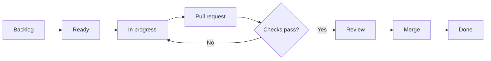

# Portfolio GitHub Project Structure

Generic conventions for managing portfolio repositories on GitHub. For the common repository checklist see [PORTFOLIO_REPO_STANDARD.md](PORTFOLIO_REPO_STANDARD.md).

## Milestones

Use native GitHub milestones named after the release goal (for example `v0.2 - Core features`, `v1.0 - Portfolio release`). Link each milestone description to a tracking issue when one exists.

## Suggested labels

| Group | Labels |
|---|---|
| Type | `type:feature`, `type:bug`, `type:chore`, `type:research`, `type:security`, `type:docs`, `type:test` |
| Area | `area:backend`, `area:frontend`, `area:data`, `area:devops`, `area:security`, `area:docs` |
| Priority | `priority:P0` ... `priority:P3` |
| Workflow | `status:blocked`, `status:needs-review`, `good-first-issue`, `help-wanted` |

## Issue lifecycle

## Branches

- Small, short-lived branches (`feature/<issue>-name`, `fix/<issue>-name`, `docs/<issue>-name`) merged into `main`.
- `main` stays releasable; avoid long-lived development branches.
- A repository owner may commit directly to `main` for small maintenance changes; this should be stated in that repository's `CONTRIBUTING.md`.

## Pull request expectations

- Explain what changed and why; link an issue when one exists.
- Include tests when behavior changes.
- Note security implications when applicable.
- Pass CI before merge.

## Releases

Use semantic versions and keep `CHANGELOG.md` (Keep a Changelog format) aligned with git tags and GitHub Releases. Tags and releases are created by the repository owner in GitHub.

## Definition of Done

- Acceptance criteria satisfied and relevant tests pass.
- Documentation updated.
- No secrets or unsafe sample data introduced.
- CI passes and the change is reviewed and merged.
